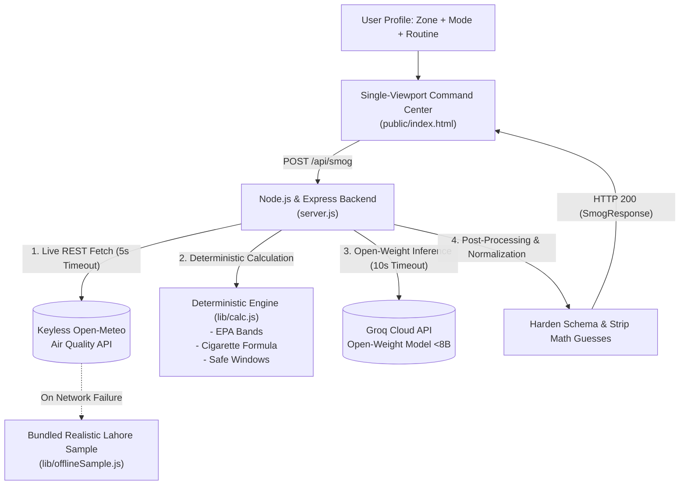

# SmogShield-LHR 🌫️🛡️
### *Real-Time Air Quality, Cigarette-Equivalence Analytics & AI-Driven Commute Optimizer*
**Event:** Hacktoberfest Lahore 2026 — Riphah International University  
**Target Viewport:** Single Command Center (`http://localhost:3000`)

---

## 🌟 1. The Executive Pitch (30-Second Elevator Pitch)

> *"Every winter in Lahore, thermal inversion traps millions in toxic, ground-level particulate smog. Conventional weather apps give abstract AQI numbers that citizens cannot translate into daily actions. **SmogShield-LHR** turns raw atmospheric data into visceral, human metrics—calculating your daily **equivalent cigarettes inhaled**, isolating **clean daytime commute windows**, and leveraging an **open-weight AI intelligence layer (<8B)** to reschedule routines and write instant **Roman Urdu WhatsApp alerts** for families."*

---

## 🚨 2. The Problem We Are Solving

1. **The Inversion Trap:** In Lahore, winter atmospheric thermal inversion traps hazardous particulates ($\text{PM}_{2.5}$ and $\text{PM}_{10}$) close to the surface, particularly during morning and evening rush hours.
2. **Abstract Numbers vs. Human Action:** Hearing "AQI 185" does not tell a student riding a motorbike to campus how much smoke they will inhale, nor does it tell an asthma patient when it is safe to open their home windows.
3. **The Communication Gap:** Non-technical family members and elders often ignore technical smog advisories. They need actionable advice delivered in their everyday language (**Roman Urdu**) directly to WhatsApp.

---

## 🛠️ 3. What SmogShield-LHR Does (Core Capabilities)

### A. Micro-Zone Telemetry & Exposure Profiling
- **5 Pre-mapped Lahore Micro-Zones:** Johar Town (Riphah), Gulberg (Kalma Chowk), Mall Road (Civil Lines), DHA Phase 5, and Shahdara Industrial Area.
- **Physiological Exposure Multipliers:**
  - **Motorbike / Yango / Bykea rider (`1.8x`):** Severe open-air respiratory particulate intake.
  - **Pedestrian / Runner (`1.5x`):** Elevated breathing rate during physical exertion.
  - **Car with AC recirculation (`0.6x`):** Sealed cabin particulate filtering.
  - **Sensitive Group / Elderly / Asthma (`2.0x`):** Elevated physiological vulnerability.

### B. Deterministic Mathematical Engine (Zero Hallucination)
- **Berkeley Earth Cigarette Equivalence Standard:**
  $$\text{Cigarettes Inhaled} = \left(\frac{\text{Mean PM}_{2.5}}{22}\right) \times \left(\frac{\text{Hours Outside}}{24}\right) \times \text{Multiplier}$$
  *(Translates $22\ \mu\text{g/m}^3$ of $\text{PM}_{2.5}$ over 24 hours into 1 cigarette).*
- **WHO Safety Multiple:** Expresses current toxic particulate concentration against the WHO 2021 24-hour limit ($15\ \mu\text{g/m}^3$).
- **Algorithmic Safe Commute Windows:** Filters the 24-hour forecast between **06:00 and 21:00 PKT** to pinpoint the top 3 cleanest hours (and top 3 peak hazard spikes) so commuters know exactly when to travel.

### C. Open-Weight AI Intelligence Layer (<8B Parameters)
- Powered strictly by **open-weight models (<8B parameters)** via the Groq Cloud API.
- Generates:
  1. **Executive Context:** Contextual analysis of current Lahore thermal inversion.
  2. **Commute Rescheduling Plan:** Specific before/after time slots with server-calculated particulate reduction percentages (e.g. *−59% reduction by shifting from 07:00 to 13:00*).
  3. **Home Ventilation Protocol:** Exact clock times for keeping windows sealed vs. when midday solar mixing permits brief air exchange.
  4. **Roman Urdu WhatsApp Family Alert:** Formatted exclusively with single asterisks (`*alert*`) for instant 1-click clipboard copying into family groups.

---

## 🏆 4. Mandatory Hackathon Compliance & Architecture

| Hackathon Criterion | How SmogShield-LHR Complies |
| :--- | :--- |
| **Strict 8B Model Limitation** | Exclusively invokes open-weight models under 8B parameters on Groq. **Zero proprietary closed-source models** (no OpenAI, no Claude, no Gemini). |
| **Secret Isolation** | `GROQ_API_KEY` is loaded strictly server-side. Zero API keys or tokens are leaked to client-side bundles. |
| **Deterministic Decoupling** | Health indices, cigarette counts, and percentages are computed in verified code—the LLM is never permitted to guess medical numbers. |
| **Resilience & Fallback** | If the live weather network fails, the system auto-switches to a bundled realistic Lahore sample and displays a visible `OFFLINE SAMPLE` badge. |
| **Single-Viewport Flow** | Zero auth friction, zero external databases. Complete journey operates in a single dark command center. |

---

## ⚡ 5. Walkthrough for Judges: The 3 Demo Presets

The top ribbon provides 3 instant evaluation scenarios:

1. **Preset 1 (Critical Exposure — Student Motorbike Commuter):**
   - *Input:* Johar Town (Riphah Campus), Motorbike (1.8x), 5 hours outside.
   - *Result:* Highlights severe exposure ($>1.5$ cigarettes), flags morning rush-hour spikes, and reschedules outdoor transit to the midday 13:00–15:00 window.
2. **Preset 2 (Vulnerable Demographic — Senior Citizen / Asthma Care):**
   - *Input:* Mall Road, Sensitive Group (2.0x weight), 2 hours outside.
   - *Result:* Recommends strict morning window sealing, shifts morning walk away from thermal inversion, and gives ventilation rules.
3. **Preset 3 (Edge-Case Test — Error Boundary & Known Limitations):**
   - *Input:* 15 hours outside (exceeds 12h limit) and an empty routine string.
   - *Result:* Client-side validation boundary instantly catches invalid input, disables submission, and generates a `PASS` row in the Markdown exporter without making any network calls.

---

## 📊 6. Automated Testing & Verification

- **11 Automated Unit Tests:** 100% pass rate (`npm test`) in under 400ms using Node.js native test runner:
  - EPA AQI boundary verification (0 through 500).
  - Cigarette equivalence mathematical worked examples.
  - Safe window 06:00–21:00 PKT daytime extraction.
  - API validation boundaries and 400 rejection.
  - Markdown table row formatting and escaping.
- **1-Click README Exporter:** Tab 3 instantly generates a compliant 6-column testing row formatted per the hackathon manual.
