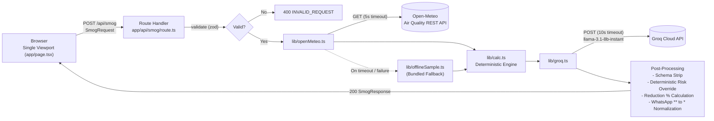

# SmogShield-LHR 🌫️🛡️

**Real-Time Air Quality, Cigarette-Equivalence Analytics & AI-Driven Commute Optimizer**  
*Hacktoberfest Lahore 2026 — Riphah International University*

[](https://hacktoberfest.com/)
[-blue.svg)](https://groq.com/)
[](https://groq.com/)
[](LICENSE)
[](CONTRIBUTING.md)
[](CODE_OF_CONDUCT.md)

---

## 1. Project Overview & Problem Statement

Lahore regularly ranks among the most polluted cities globally during the winter months. A seasonal meteorological phenomenon known as **thermal inversion** traps hazardous particulate matter ($\text{PM}_{2.5}$ and $\text{PM}_{10}$) close to the ground, resulting in toxic smog levels that severely impact public health.

While conventional weather apps report raw AQI indices, citizens struggle to translate abstract numbers into everyday decisions:
- *How much smoke did I actually inhale during my motorbike commute today?*
- *When is the safest time between morning and evening to travel or exercise outside?*
- *When should I open windows for ventilation or run HEPA filtration?*
- *How can I quickly alert non-technical family members in simple, accessible language?*

**SmogShield-LHR** addresses this gap by converting live open-access telemetry into deterministic health metrics (EPA AQI bands, WHO safety multiples, Berkeley Earth cigarette equivalence) combined with a strict open-weight **8B AI intelligence layer** (`llama-3.1-8b-instant`) to reschedule routines and generate localized Roman Urdu WhatsApp family alerts.

---

## 2. Architecture & Strict 8B Model Compliance



### 🔒 Strict Hackathon Guardrails & Model Isolation
- **Strict 8B Model Limitation:** Runtime AI logic strictly invokes `llama-3.1-8b-instant` (8 Billion parameters open-weight model) via Groq Cloud API.
- **Zero Closed-Source Runtimes:** No OpenAI, Anthropic Claude, or Google Gemini/70B+ frontier models are imported or called.
- **Deterministic Risk Decoupling:** Risk severity bands (`GOOD` through `HAZARDOUS`) and exposure percentages are computed deterministically in code—the LLM is never permitted to guess medical risk or calculate arithmetic.
- **Secret Isolation:** `GROQ_API_KEY` is loaded purely server-side. Zero client exposure.

---

## 3. Key Features & Deterministic Formulas

### 📍 Micro-Zone Geolocation & Exposure Multipliers
Pre-calibrated for 5 major Lahore meteorological zones:
1. **Johar Town / Riphah Campus** (`31.4697, 74.2728`)
2. **Gulberg / Kalma Chowk** (`31.5204, 74.3587`)
3. **Mall Road / Civil Lines** (`31.5580, 74.3292`)
4. **DHA Phase 5** (`31.4720, 74.4110`)
5. **Shahdara Industrial** (`31.6215, 74.2825`)

Transportation intake coefficients account for physiological breathing rate and protective enclosure:
- **Motorbike / Yango / Bykea rider:** `1.8x` multiplier (heavy open-air particulate intake)
- **Pedestrian / Runner:** `1.5x` multiplier (elevated exertion)
- **Car / Sealed Cabin:** `0.6x` multiplier (recirculated filtration)
- **Sensitive Group (Elderly / Asthma):** `2.0x` vulnerability weight

### 🧮 Mathematical Calculation Engine
- **Berkeley Earth Cigarette Equivalence:**
  $$\text{Cigarettes} = \left(\frac{\text{Mean PM}_{2.5}}{22}\right) \times \left(\frac{\text{Hours Outside}}{24}\right) \times \text{Multiplier}$$
  *(22 µg/m³ of PM2.5 over 24 hours ≈ 1 cigarette inhaled)*
- **WHO Safety Multiple:**
  $$\text{WHO Multiple} = \frac{\text{Current PM}_{2.5}}{15\ \mu\text{g/m}^3}$$
- **Algorithmic Safe Windows:** Isolates the top 3 cleanest hours and top 3 peak spikes within daytime commute hours (06:00 to 21:00 PKT).
- **Automated Roman Urdu WhatsApp Alerts:** Synthesizes single-asterisk formatted alerts (`*Alert*`) ready for 1-click clipboard copy into family chats.

---

## 4. Setup, Installation & Demo Presets

### Prerequisites
- Node.js 18+ or 20+
- A free [Groq Cloud API Key](https://console.groq.com/)

### Quickstart Guide

1. **Clone the repository:**
   ```bash
   git clone https://github.com/ahmmikun/MLH-Hacktoberfest.git
   cd MLH-Hacktoberfest
   ```

2. **Configure environment variables:**
   ```bash
   cp .env.example .env.local
   ```
   Add your Groq API Key to `.env.local`:
   ```env
   GROQ_API_KEY=gsk_your_key_here
   ```

3. **Install dependencies:**
   ```bash
   npm install
   ```

4. **Launch development server:**
   ```bash
   npm run dev
   ```
   Open `http://localhost:3000` in your browser.

5. **Run test suite:**
   ```bash
   npm test
   ```

### ⚡ One-Click Judge Demo Presets
The dashboard includes 3 one-click preset buttons for evaluation:
- **Preset 1 (Critical Exposure):** Johar Town (Riphah), Bike rider, 5 Hours outside. Demonstrates heavy particulate inhalation and schedule optimization.
- **Preset 2 (Vulnerable Demographic):** Mall Road, Senior citizen / Asthma care, 2 Hours outside. Demonstrates sensitive group shielding and indoor ventilation rules.
- **Preset 3 (Edge-Case & Limitation):** Out-of-bounds input (15 hours, empty routine). Demonstrates client-side validation boundary without consuming network or API quotas.

---

## 5. Testing, Findings & Known Limitations

### 🧪 Evaluation & Testing Matrix

| Test Scenario | Input Profile | Expected Output | Actual Outcome | Status | Notes / Limitations |
| :--- | :--- | :--- | :--- | :--- | :--- |
| **Preset 1: Bike Student Commute** | Johar Town, Bike (1.8x), 5 hrs, Univ commute routine | Severe exposure flagged; cigarette equiv calculated; safe window 13:00–15:00 suggested | Live Open-Meteo telemetry processed, 8B AI generated Roman Urdu alert & schedule shift | `PASS` | Commute optimization bounded to 06:00–21:00 PKT |
| **Preset 2: Asthma Vulnerable Care** | Mall Road, Sensitive (2.0x), 2 hrs, Park walk & pharmacy | High vulnerability warning; morning walk rescheduled away from peak inversion | Strict 2.0x weight applied, ventilation hours mapped to midday | `PASS` | Telemetry resolution based on regional CAMS forecast |
| **Preset 3: Edge Case / Validation Boundary** | 15 hrs outside, empty routine string | Client-side validation blocks submission; inline error messages displayed | Request blocked; 0 network calls sent to `/api/smog`; form error shown | `PASS` | Boundary limitation: hours strictly capped between 1 and 12 |

### ⚠️ Known Limitations & Disclaimers
1. **Not Medical Advice:** SmogShield-LHR is an educational and decision-support tool. It does not provide medical diagnoses or clinical prescriptions.
2. **Spatial Telemetry Granularity:** Outside Europe, Open-Meteo relies on global CAMS models (~45 km resolution). While micro-zones use precise latitude/longitude, values reflect atmospheric regional interpolation.
3. **Offline Fallback Sample:** If Open-Meteo is unreachable or times out (5000 ms), the system automatically loads a verified bundled Lahore sample with a visible `OFFLINE SAMPLE` indicator.

---

## 📚 Technical Documentation & Specification

SmogShield-LHR is built using spec-driven development. Detailed engineering specifications:
- **[Requirements Document (docs/requirements.md)](docs/requirements.md)**: User stories and EARS acceptance criteria (R1–R11).
- **[Design Architecture (docs/design.md)](docs/design.md)**: Component hierarchy, API contracts, algorithms, and design tokens.
- **[Implementation Checklist (docs/tasks.md)](docs/tasks.md)**: Phased test-first tasks mapped to build requirements.
- **[Agent Protocol (orchestration/HACKATHON_AGENT_PROTOCOL.md)](orchestration/HACKATHON_AGENT_PROTOCOL.md)**: Multi-agent coordination and guardrails.

---

## 🤝 Contributing & Community

Contributions are welcome! Please consult our community standards before opening PRs:
- **[Contributing Guide (CONTRIBUTING.md)](CONTRIBUTING.md)**: Contribution standards, PR checklists, and 8B model compliance rules.
- **[Code of Conduct (CODE_OF_CONDUCT.md)](CODE_OF_CONDUCT.md)**: Contributor Covenant v2.1.
- **[Security Policy (SECURITY.md)](SECURITY.md)**: Vulnerability disclosure and API key safety.

---

## 📄 License

This project is licensed under the [MIT License](LICENSE).
