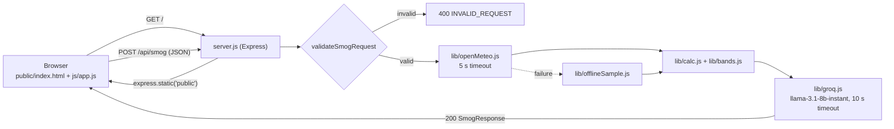

# Stack Migration Plan: Next.js → HTML/CSS/JS + Node/Express

**Status:** Approved by the coordinator at 11:52 PKT, 2026-10-15
**Scope:** This document changes only the **technology stack**. Product behaviour still comes from [`docs/requirements.md`](docs/requirements.md) (R1–R11) and [`docs/design.md`](docs/design.md). Those files are deliberately left unchanged, so any point where they mention Next.js, TypeScript, Tailwind, framer-motion, lucide-react, zod, or Vitest is overridden by §3 below.

## 1. Target Stack

| Layer | Old (docs/design.md) | New |
|-------|----------------------|-----|
| Runtime | Next.js App Router | **Node.js 24** + **Express 4** |
| Language | TypeScript | **JavaScript (ES modules, `"type": "module"`)**, with JSDoc types where useful |
| Frontend | React components | **Static `public/index.html` + `public/css/styles.css` + `public/js/*.js`** (native ES modules, no build step) |
| Styling | Tailwind CSS | **Plain CSS** with custom properties for the design tokens |
| Animation | framer-motion | **CSS transitions/keyframes** (`opacity`, `transform` only) + `@media (prefers-reduced-motion: reduce)` |
| Icons | lucide-react | **Inline SVG** copied from Lucide (ISC licence, no dependency) |
| Validation | zod | **Hand-written validators** (request in `server.js`; AI output in `lib/groq.js`) |
| Tests | Vitest + RTL | **`node --test`** (built in, zero deps). The route is tested by calling a running app with `fetch`. |
| Env loading | Next env | `dotenv` (`.env.local`, then `.env`) |
| Package manager | — | **Undecided, see §6.1** |

## 2. Architecture



The API contract (`SmogRequest` / `SmogResponse`, status codes, `aiError` codes) is **unchanged** from `docs/design.md` §Data Models and §API Contract.

### File Layout

```
server.js                 Express app: static hosting, GET /api/presets, POST /api/smog
lib/                      server-side domain logic (ES modules)
  config.js               MODEL_ID, PROVIDER, timeouts, constants, PORT
  zones.js                ZONES, MODES, PRESETS
  bands.js                aqiToBand(), BAND_TOKENS
  calc.js                 computeMetrics() and helpers
  openMeteo.js            fetchTelemetry() + validation + offline fallback
  offlineSample.js        bundled Lahore snapshot
  groq.js                 SYSTEM_PROMPT, fetchInsight(), post-processing
  exportRow.js            buildTestingRow()
public/                   static frontend (no build step)
  index.html              single-viewport command center
  css/styles.css          tokens, layout, band colours, motion, reduced-motion
  js/app.js               state, form, presets, fetch /api/smog, render
  js/render.js            hero cards, histogram, tabs (DOM builders)
  js/icons.js             inline SVG strings
  js/exportRow.js         client copy of the README row builder (or import from /lib, see §6.3)
tests/
  bands.test.js  calc.test.js  openMeteo.test.js  groq.test.js
  exportRow.test.js  route.test.js
.env.example              GROQ_API_KEY=
```

## 3. Overrides to `docs/` (read these instead of the matching doc text)

| docs reference | Replace with |
|----------------|--------------|
| `app/page.tsx` | `public/index.html` + `public/js/app.js` |
| `app/api/smog/route.ts` | `POST /api/smog` handler in `server.js` |
| `lib/*.ts` | `lib/*.js` |
| `lib/schemas.ts` (zod) | `validateSmogRequest()` in `server.js`, plus AI-output validation in `lib/groq.js`. Same rules as design.md §Output Schema. |
| `components/**`, `components/ui/**` | DOM builder functions in `public/js/render.js` |
| Tailwind classes in §UI Design System | CSS custom properties and classes in `public/css/styles.css`, with the same hex values. Band classes: `.band-good`, `.band-moderate`, `.band-usg`, `.band-unhealthy`, `.band-very-unhealthy`, `.band-hazardous`. |
| framer-motion stagger (0.06 s) / histogram `scaleY` | CSS `@keyframes` with `animation-delay: calc(var(--i) * 60ms)`; bars use `transform: scaleY()` with `transform-origin: bottom` |
| `useReducedMotion()` | `@media (prefers-reduced-motion: reduce) { *, *::before, *::after { animation: none !important; transition: none !important; } }` |
| lucide-react icons | Inline SVG in `public/js/icons.js` (Bike, Footprints, Car, ShieldAlert, Copy, Check, RefreshCw, WifiOff) |
| `next/font/google` | `<link>` to Google Fonts for Inter + JetBrains Mono, with system fallbacks (`system-ui`, `Courier New`) so the page still works offline |
| Vitest / RTL, `npx vitest run` | `node --test tests/` (`npm test`). UI is verified manually through the 3 presets. |
| D12 (zod + Vitest), D13 (framer `scaleY`) | Superseded by the rows above |
| R10.5 "no route other than `/` and `/api/smog`" | Also allows static assets under `public/` and the read-only `GET /api/presets` |

Unchanged: all of R1–R9 and R11, design decisions D1–D11, formulas, AQI bands, presets, error-handling table, and known limitations.

## 4. Task Breakdown (replaces `docs/tasks.md` task numbering for the new stack)

| # | Task | Owner | Status (observed 11:52) | Requirements |
|---|------|-------|-------------------------|--------------|
| M1 | `package.json` (ESM, `start`/`dev`/`test` scripts), `.env.example`, `.gitignore` | ? (see §6.2) | **Done** (`express`, `cors`, `dotenv` installed via npm) | R10.2, R10.3 |
| M2 | `lib/config.js`, `zones.js`, `bands.js`, `calc.js` | ? | **Written, untested** | R2, R3, R5 |
| M3 | `lib/openMeteo.js`, `lib/offlineSample.js` | ? | **Written, untested** | R4, R9.1 |
| M4 | `lib/groq.js` (prompt, timing, post-processing) | ? | **Written, untested** | R1, R6, R9.3, R9.5 |
| M5 | `server.js` route + validation | ? | **Written, untested** | R9.6, R10.1 |
| M6 | `lib/exportRow.js` | ? | **Written, untested** | R8 |
| M7 | `tests/*.test.js` with `node --test` (cases from design.md §Testing Strategy) | Kiro (proposed) | Not started | R5, R6, R8, R9 |
| M8 | `public/index.html` + `css/styles.css`: tokens, header badge, preset ribbon, 4/8 grid | Antigravity (proposed) | Not started | R7.1–R7.3, R11 |
| M9 | `public/js/app.js`: form state, client validation (same rules as server), presets incl. Preset 3 no-fetch, `fetch('/api/smog')`, loading/error/offline states | Antigravity (proposed) | Not started | R2.5, R2.6, R3, R9.2, R9.4 |
| M10 | `public/js/render.js`: hero cards, 24-bar histogram, tabs (WAI-ARIA), copy buttons, README row | Antigravity (proposed) | Not started | R7.4–R7.8, R8, R11.3–R11.5 |
| M11 | Remove the Next.js scaffold (`app/`, `next.config.ts`, `next-env.d.ts`, `tsconfig.json`, `eslint.config.mjs`, `AGENTS.md`, Next SVGs in `public/`) | Kiro, **after approval** | Not started (the scaffold was committed in `4a68c51`) | — |
| M12 | README update (stack, setup, Mermaid, testing table), compliance audit, demo run | Kiro + coordinator | Not started | R1, R10.4, R11.1, R11.7 |

Order: M7 (tests for the existing lib) → M11 → M8–M10 in parallel with test fixes → M12.

## 5. Review Notes on the Current Backend

These are findings to fix in M5 and M7. None of them have been changed yet.

1. **`app.use(cors())` allows every origin.** The frontend is served from the same origin, so CORS isn't needed. Leaving it on lets any website call `/api/smog` and spend the Groq quota. Remove it (and the `cors` dependency), or restrict it to `http://localhost:3000`.
2. **No body-size limit.** Use `express.json({ limit: "10kb" })`.
3. **The endpoint is unauthenticated and has no rate limiting.** That's acceptable for a local demo, but don't deploy it publicly without a simple per-IP limit.
4. **`app.get("*")` catch-all** works on Express 4 but **breaks on Express 5** (path-to-regexp v8). Keep Express pinned to 4.x, or switch to `app.use((req, res) => res.sendFile(...))`.
5. **`app.listen` runs at import time,** so `tests/route.test.js` can't import the app. Split it into `app.js` (`export const app`) and `server.js` (`app.listen`), or guard the listen with `if (process.argv[1] === __filename)`.
6. **`^` version ranges** in `package.json` contradict the "pin exact versions" rule (CONTRIBUTING, D12). Re-pin with `--save-exact`.
7. ~~Open-Meteo hour parsing timezone bug~~ **Retracted after testing.** Open-Meteo timestamps have no offset (`2026-10-15T06:00`), and JavaScript reads offset-less date-times as local time, so `getHours()` returns the literal hour on any server timezone. The `transformOpenMeteoData` regex is still the clearer approach.
8. **The 500 path** returns a generic message. That's good, as long as no stack trace leaks; keep it that way.

## 6. Open Decisions (coordinator)

1. **Package manager:** at 11:40 you said to "discard npm and use Bun", but the new backend was installed with **npm** (`package-lock.json`, `node_modules/`). Choose one:
   - **npm:** keep `package-lock.json`. No extra setup; Node 24 already includes npm 12.
   - **Bun:** delete `package-lock.json`, run `bun install` to create `bun.lock`, and fix the broken global `bun` shim first. Node stays the runtime.
2. **Ownership:** someone other than Kiro wrote `server.js` and `lib/*.js` (11:45–11:52), but `orchestration/HACKATHON_STATUS.md` still lists `lib/*` as Kiro-owned. Who owns M1–M6 from now on?
3. **Shared logic on the client:** either serve `lib/zones.js`, `lib/bands.js`, and `lib/exportRow.js` to the browser (e.g. `app.use("/lib", express.static("lib"))`, safe because none of them read `process.env`), or keep separate copies in `public/js/`. Serving them avoids drift, but `lib/config.js` reads `process.env`, so expose only the safe files.
4. **M11 approval:** delete the committed Next.js scaffold files listed above.

## 7. Verification (Definition of Done)

```powershell
npm test                          # node --test: all suites pass
npm start                         # http://localhost:3000 serves index.html
# Preset 1 → 200 with metrics + ai, badge shows measured latency
# Preset 2 → elder_asthma 2.0x applied
# Preset 3 → inline errors, zero requests in DevTools Network tab
# Disconnect network → OFFLINE SAMPLE badge, metrics still render
git grep -niE "openai|anthropic|gemini|70b" -- . ":!docs" ":!*.md"   # only api.groq.com/openai/v1
git grep -n "GROQ_API_KEY" -- public                                  # must return nothing
git check-ignore .env.local                                           # prints .env.local
```
