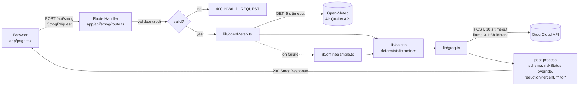
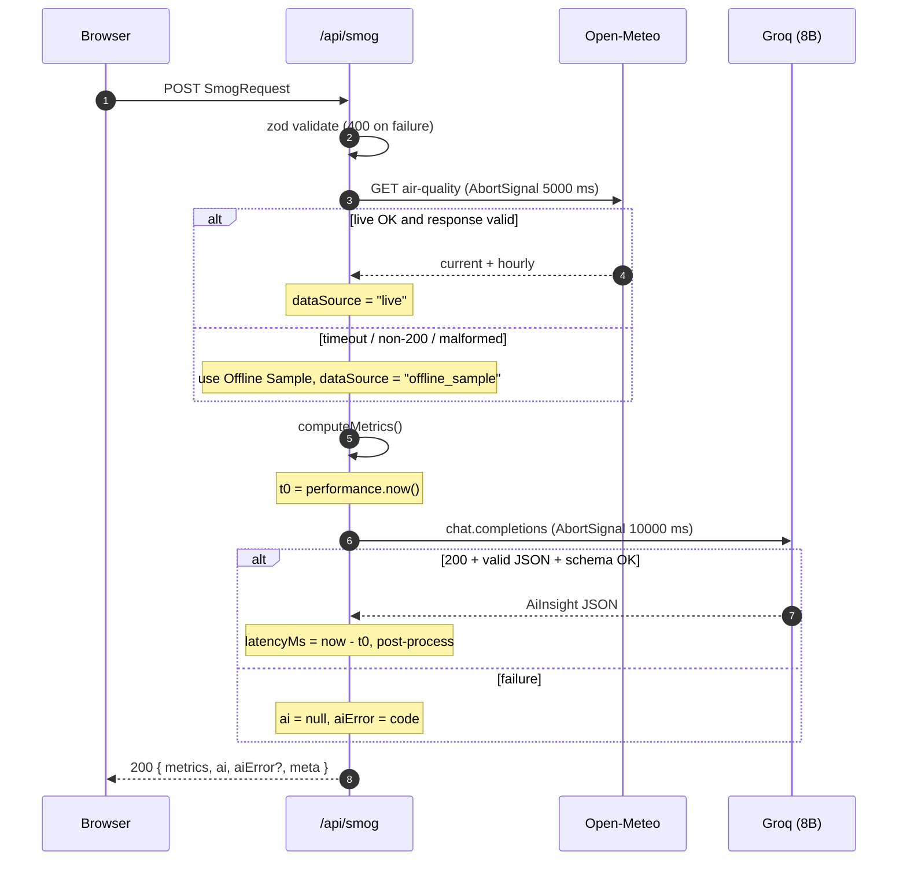
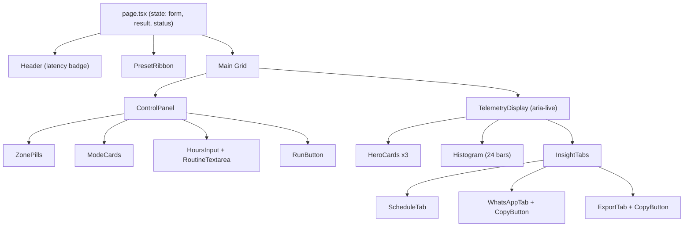

# Design Document

## Overview

SmogShield-LHR is a single Next.js App Router application with one page (`app/page.tsx`) and one Route Handler (`app/api/smog/route.ts`). All work happens on the server: the Route Handler validates the request, fetches telemetry from Open-Meteo, computes deterministic metrics, and asks `llama-3.1-8b-instant` on Groq for the narrative fields. The client only collects input and renders the result.

Requirement IDs (`R1`–`R11`) refer to [requirements.md](requirements.md). The build order is in [tasks.md](tasks.md).

### Design Decisions

| # | Decision | Rationale | Req |
|---|----------|-----------|-----|
| D1 | Use the full 6-band US AQI scale (`GOOD`, `MODERATE`, `USG`, `UNHEALTHY`, `VERY_UNHEALTHY`, `HAZARDOUS`). The server computes `riskStatus` from current `us_aqi`, and the LLM never decides risk. | Lahore readings often fall in 150–300, so a 4-level scale would merge bands that mean very different things. Server-side calculation keeps the safety signal reproducible. | R5, R6 |
| D2 | Colour bands follow EPA convention: emerald, yellow, orange, red, purple, rose. Hazardous uses stronger tints (`/15`, `/40`). | Matches what people already expect from AQI colours, and the stronger tints make the worst band stand out on a projector. | R7 |
| D3 | Card surfaces use `slate-900` = `#0F172A` at 80% opacity with blur. | The original spec paired the `slate-900` class with gray-900's hex code. This fixes the mismatch. | R7 |
| D4 | Preset 2 uses mode `elder_asthma` (Mall Road, 2 h). `elder_asthma` means "sensitive group (elderly / asthma)", not "indoors". | The preset label should match its mode, and someone with 2 h outdoors isn't staying indoors. | R2, R3 |
| D5 | Preset 3 = empty routine plus `hoursOutside` = 15. Client-side validation blocks it, and no API call is made. | Shows the error boundary without depending on the network. It's also the documented limitation row. | R3, R8 |
| D6 | Latency is measured on the server around the Groq call and returned as `meta.latencyMs`. The badge shows `—` until then. | A hardcoded number could mislead judges. | R6, R7 |
| D7 | `cigarettes = (meanPm25 / 22) × (hoursOutside / 24) × multiplier`, rounded to 1 decimal. | Berkeley Earth: 22 µg/m³ of PM2.5 over 24 h ≈ 1 cigarette. | R5 |
| D8 | `whoMultiple = currentPm25 / 15`. | WHO 2021 24-hour PM2.5 guideline. | R5 |
| D9 | Safe Windows and Peak Spikes are the 3 lowest and 3 highest PM2.5 hours within 06–21 PKT. Ties go to the earlier hour. | Deterministic, testable, and limited to realistic commute hours. | R5 |
| D10 | `reductionPercent` is recomputed on the server from hourly data, and any model value is discarded. | An 8B model can't be trusted to do arithmetic. | R6 |
| D11 | If Groq fails, the response still includes metrics, with `ai: null` and `aiError`. If Open-Meteo fails, the bundled Offline Sample is used and clearly labelled. | The demo survives network failures, and data is never silently faked. | R9 |
| D12 | Validation uses `zod`. Tests use Vitest + React Testing Library. Exact dependency versions are pinned at scaffold time. | One schema library serves both the request and the AI output. Vitest is fast enough for a 2.5 h build. | R6, R9 |
| D13 | Histogram growth is animated with `scaleY` (origin bottom), not the `height` property. | Gives the same visual result with no layout reflow. | R11 |

## Architecture





### Module Layout

```
app/
  layout.tsx            fonts, <html class="dark">, metadata
  page.tsx              client dashboard (state, presets, fetch)
  globals.css           Tailwind layers, reduced-motion overrides
  api/smog/route.ts     POST handler (runtime = "nodejs", dynamic = "force-dynamic")
lib/
  config.ts             MODEL_ID, PROVIDER, timeouts, WHO/Berkeley constants
  zones.ts              ZONES, MODES (ids, labels, coords, multipliers, icons)
  presets.ts            PRESETS 1–3
  bands.ts              aqiToBand(), BAND_TOKENS
  calc.ts               computeMetrics() and its pure helpers
  openMeteo.ts          fetchTelemetry() + response validation
  offlineSample.ts      captured real Lahore response (static JSON)
  groq.ts               fetchInsight(), prompt builder, post-processing
  schemas.ts            zod: SmogRequestSchema, AiInsightSchema
  exportRow.ts          buildTestingRow()
components/
  ui/                   Card, Badge, Button, Tabs, Textarea, Input (Shadcn-style, no install)
  Header.tsx  PresetRibbon.tsx  ControlPanel.tsx
  HeroCards.tsx  Histogram.tsx  InsightTabs.tsx  CopyButton.tsx
tests/
  calc.test.ts  bands.test.ts  schemas.test.ts  openMeteo.test.ts
  groq.test.ts  route.test.ts  exportRow.test.ts  ui.test.tsx
```

## Tech Stack

| Layer | Choice | Notes |
|-------|--------|-------|
| Framework | Next.js (App Router) + TypeScript | Route Handlers keep API calls and the key on the server. No Server Actions are needed. |
| Styling | Tailwind CSS, PostCSS, `clsx`, `tailwind-merge` | `cn()` helper in `lib/utils.ts`. |
| UI primitives | Custom Shadcn-style components in `components/ui/` | Tabs follow the WAI-ARIA Tabs pattern (see §Accessibility). |
| Motion | `framer-motion` | Stagger plus histogram growth. Respects `useReducedMotion()`. |
| Icons | `lucide-react` | `Bike`, `Footprints`, `Car`, `ShieldAlert`, `Copy`, `Check`, `RefreshCw`, `WifiOff`. |
| Validation | `zod` | Validates both the request and the AI output. |
| Testing | Vitest, `@testing-library/react`, `@testing-library/user-event`, `jsdom` | `fetch` is mocked with `vi.stubGlobal`. |
| Fonts | `Inter`, `JetBrains Mono` via `next/font/google` | Self-hosted at build time. |

Dependency versions are pinned exactly (`npm install --save-exact`) when the project is scaffolded. This document deliberately doesn't list version numbers.

## External Integrations

### Open-Meteo Air Quality API (keyless)

```
GET https://air-quality-api.open-meteo.com/v1/air-quality
  ?latitude={zone.lat}&longitude={zone.lon}
  &current=us_aqi,pm2_5,pm10,carbon_monoxide,nitrogen_dioxide
  &hourly=us_aqi,pm2_5,pm10,uv_index
  &timezone=Asia%2FKarachi
  &forecast_days=1
```

- `fetch(url, { signal: AbortSignal.timeout(5000), cache: "no-store" })`.
- With `forecast_days=1`, `hourly.time` has 24 local timestamps (`YYYY-MM-DDT00:00` … `T23:00`).
- Hourly values may be `null`. They are kept in the histogram as empty bars but excluded from means and rankings.
- The response is validated per R4.5. Any failure falls back to the Offline Sample (D11).

### Groq Cloud API (8B only)

```
POST https://api.groq.com/openai/v1/chat/completions
Authorization: Bearer ${process.env.GROQ_API_KEY}
Content-Type: application/json
```

```json
{
  "model": "llama-3.1-8b-instant",
  "temperature": 0.1,
  "max_tokens": 1200,
  "response_format": { "type": "json_object" },
  "messages": [
    { "role": "system", "content": "<SYSTEM_PROMPT – see §AI Layer>" },
    { "role": "user", "content": "<JSON.stringify(promptInput)>" }
  ]
}
```

- `fetch(url, { method: "POST", signal: AbortSignal.timeout(10000) })`. This uses plain `fetch` with no SDK, so there's no dependency on any vendor library (R1.2).
- The insight is read from `choices[0].message.content`, parsed with `JSON.parse`, then checked with `AiInsightSchema.safeParse`.

## Data Models

```ts
export type ZoneId = "riphah_johar" | "gulberg" | "mall_road" | "dha" | "shahdara";
export type ExposureMode = "bike" | "walk" | "car" | "elder_asthma";
export type RiskBand =
  | "GOOD" | "MODERATE" | "USG" | "UNHEALTHY" | "VERY_UNHEALTHY" | "HAZARDOUS";

export interface Zone {
  id: ZoneId;
  label: string;
  lat: number;
  lon: number;
}

export interface Mode {
  id: ExposureMode;
  label: string;
  multiplier: number;              // 1.8 | 1.5 | 0.6 | 2.0
  icon: "Bike" | "Footprints" | "Car" | "ShieldAlert";
}

export interface SmogRequest {
  zone: ZoneId;
  mode: ExposureMode;
  hoursOutside: number;            // integer 1–12
  userRoutine: string;             // 3–500 chars after trim
}

export interface Telemetry {
  current: {
    time: string;                  // ISO local, PKT
    usAqi: number;
    pm25: number;
    pm10: number;
    co: number;                    // µg/m³
    no2: number;                   // µg/m³
  };
  hourly: Array<{
    hour: number;                  // 0–23 PKT
    usAqi: number | null;
    pm25: number | null;
    pm10: number | null;
    uvIndex: number | null;
  }>;                              // length 24
}

export interface HourValue {
  hour: number;
  pm25: number;
}

export interface Metrics {
  riskStatus: RiskBand;
  usAqi: number;
  pm25: number;
  pm10: number;
  co: number;
  no2: number;
  meanPm25: number;                // 1 decimal
  whoMultiple: number;             // 1 decimal
  cigarettes: number;              // 1 decimal
  safeWindows: HourValue[];        // length 3, ascending pm25
  peakSpikes: HourValue[];         // length 3, descending pm25
  hourly: Telemetry["hourly"];
}

export interface RescheduleItem {
  originalSlot: string;            // "HH:00"
  optimizedSlot: string;           // "HH:00", 06–21
  reductionPercent: number;        // server-computed integer
  reason: string;
}

export interface AiInsight {
  executiveSummary: string;
  rescheduledPlan: RescheduleItem[];
  homeVentilationAdvice: string;
  whatsappFamilyAlert: string;     // Roman Urdu, single *asterisks*
}

export type AiErrorCode =
  | "AI_NOT_CONFIGURED" | "AI_TIMEOUT" | "AI_UPSTREAM_ERROR"
  | "AI_INVALID_JSON" | "AI_SCHEMA_MISMATCH";

export interface SmogResponse {
  metrics: Metrics;
  ai: AiInsight | null;
  aiError?: AiErrorCode;
  meta: {
    model: "llama-3.1-8b-instant";
    provider: "Groq";
    latencyMs: number | null;      // null if Groq was not called
    dataSource: "live" | "offline_sample";
    zone: ZoneId;
    generatedAt: string;           // ISO 8601
  };
}
```

## API Contract: `POST /api/smog`

| Status | When | Body |
|--------|------|------|
| `200` | Valid request. This includes AI failure and Offline Sample fallback. | `SmogResponse` |
| `400` | Request body fails `SmogRequestSchema`, or isn't valid JSON | `{ "error": "INVALID_REQUEST", "fieldErrors": Record<string, string[]> }` |
| `405` | Any method other than POST (Next.js default) | — |

Example request:

```json
{
  "zone": "riphah_johar",
  "mode": "bike",
  "hoursOutside": 5,
  "userRoutine": "Depart on bike for university at 8 AM, return at 2 PM, evening walk on rooftop at 6 PM"
}
```

Example response (abbreviated):

```json
{
  "metrics": {
    "riskStatus": "UNHEALTHY",
    "usAqi": 178,
    "pm25": 165.0,
    "pm10": 240.0,
    "co": 1450.0,
    "no2": 62.0,
    "meanPm25": 110.0,
    "whoMultiple": 11.0,
    "cigarettes": 1.9,
    "safeWindows": [{ "hour": 14, "pm25": 62.0 }, { "hour": 15, "pm25": 64.5 }, { "hour": 13, "pm25": 70.1 }],
    "peakSpikes":  [{ "hour": 8, "pm25": 188.0 }, { "hour": 21, "pm25": 176.2 }, { "hour": 7, "pm25": 171.9 }],
    "hourly": [{ "hour": 0, "usAqi": 190, "pm25": 150.2, "pm10": 220.0, "uvIndex": 0 }]
  },
  "ai": {
    "executiveSummary": "Morning thermal inversion traps PM2.5 near ground level…",
    "rescheduledPlan": [
      { "originalSlot": "08:00", "optimizedSlot": "14:00", "reductionPercent": 67, "reason": "Midday mixing layer disperses particulates." }
    ],
    "homeVentilationAdvice": "Keep windows closed 06:00–10:00 and after 19:00; ventilate 13:00–15:00; run HEPA on high overnight.",
    "whatsappFamilyAlert": "*Smog Alert – Johar Town*\nAaj AQI 178 hai (*Unhealthy*). Subah 8 baje bike se na niklein…"
  },
  "meta": {
    "model": "llama-3.1-8b-instant",
    "provider": "Groq",
    "latencyMs": 412,
    "dataSource": "live",
    "zone": "riphah_johar",
    "generatedAt": "2026-10-15T09:00:00+05:00"
  }
}
```

## Algorithms

### AQI Band Mapping (`lib/bands.ts`)

Open-Meteo returns `us_aqi` already computed using EPA breakpoints, which include the 2024 PM2.5 revision where Good = 0–9 µg/m³. The app only maps the AQI integer to a band:

| `us_aqi` | Band | Label |
|----------|------|-------|
| 0–50 | `GOOD` | Good |
| 51–100 | `MODERATE` | Moderate |
| 101–150 | `USG` | Unhealthy for Sensitive Groups |
| 151–200 | `UNHEALTHY` | Unhealthy |
| 201–300 | `VERY_UNHEALTHY` | Very Unhealthy |
| ≥ 301 | `HAZARDOUS` | Hazardous |

`aqiToBand(aqi)` rounds to the nearest integer first. Negative values are clamped to 0.

### Cigarette Equivalence

```
meanPm25   = mean(hourly.pm25 where not null)
cigarettes = round1( (meanPm25 / 22) × (hoursOutside / 24) × multiplier )
```

Worked examples (`meanPm25` = 110 µg/m³):

| Profile | Calculation | Result |
|---------|-------------|--------|
| Preset 1: bike, 5 h | 110/22 = 5.0 → × 5/24 = 1.0417 → × 1.8 = 1.875 | **1.9** |
| Preset 2: elder_asthma, 2 h | 5.0 × 2/24 = 0.4167 → × 2.0 = 0.833 | **0.8** |
| car, 12 h | 5.0 × 12/24 = 2.5 → × 0.6 = 1.5 | **1.5** |

### WHO Multiple

`whoMultiple = round1(current.pm25 / 15)`. For example, 165 µg/m³ gives **11.0×**.

### Safe Windows and Peak Spikes

```
candidates = hourly.filter(h => 6 <= h.hour <= 21 && h.pm25 !== null)
safe  = candidates.sort((a,b) => a.pm25 - b.pm25 || a.hour - b.hour).slice(0, 3)
peaks = candidates.sort((a,b) => b.pm25 - a.pm25 || a.hour - b.hour).slice(0, 3)
```

`openMeteo.ts` guarantees at least 12 non-null hours across the whole day, but that doesn't guarantee 3 non-null hours inside 06–21. If fewer than 3 are available there, the telemetry is treated as malformed and the Offline Sample is used (R4.5, R9.1).

### Reduction Percent

For each AI plan item, `orig = pm25 at originalSlot hour` and `opt = pm25 at optimizedSlot hour`, giving `reductionPercent = round((orig − opt) / orig × 100)`. If either value is null or `orig` = 0, the result is `0`. Items whose `optimizedSlot` hour is outside 6–21 are dropped. If every item is dropped, the result is `AI_SCHEMA_MISMATCH`.

## AI Layer

### Prompt Input

```ts
{
  zone: zone.label,
  mode: mode.label,
  hoursOutside,
  userRoutine,
  riskStatus, usAqi, pm25, whoMultiple, cigarettes,
  hourlyPm25: "06:95 07:172 08:188 …",   // compact 06–21 string
  safeWindows: ["14:00", "15:00", "13:00"],
  peakSpikes:  ["08:00", "21:00", "07:00"]
}
```

### System Prompt Outline

1. Role: an air-quality health assistant for Lahore residents. It gives practical, non-medical guidance.
2. Respond with one JSON object only, with exactly the keys `executiveSummary`, `rescheduledPlan`, `homeVentilationAdvice`, `whatsappFamilyAlert`.
3. Treat the provided numbers as facts. Don't invent or recalculate AQI, PM2.5, or risk level.
4. `rescheduledPlan`: for each outdoor activity in `userRoutine`, give `originalSlot` and `optimizedSlot` as `HH:00` (optimized slots must be 06:00–21:00 and should prefer `safeWindows`), plus a one-sentence `reason`.
5. `executiveSummary` is at most 3 sentences and should mention winter thermal inversion where relevant.
6. `homeVentilationAdvice` must include specific clock times for opening windows and running HEPA filtration.
7. `whatsappFamilyAlert` must be written in Roman Urdu and be 600 characters or fewer. Bold text uses single asterisks (`*bold*`) only, never `**`.
8. Don't give medical diagnoses. Advise seeing a doctor if symptoms appear.

### Output Schema (`lib/schemas.ts`)

```ts
const slot = z.string().regex(/^([01]\d|2[0-3]):00$/);

export const AiInsightSchema = z.object({
  executiveSummary: z.string().min(1).max(600),
  rescheduledPlan: z.array(z.object({
    originalSlot: slot,
    optimizedSlot: slot,
    reason: z.string().min(1).max(200),
  })).min(1).max(5),
  homeVentilationAdvice: z.string().min(1).max(400),
  whatsappFamilyAlert: z.string().min(1).max(600),
}).strip();   // drops any extra keys, e.g. riskStatus or reductionPercent

export const SmogRequestSchema = z.object({
  zone: z.enum(["riphah_johar", "gulberg", "mall_road", "dha", "shahdara"]),
  mode: z.enum(["bike", "walk", "car", "elder_asthma"]),
  hoursOutside: z.number().int().min(1).max(12),
  userRoutine: z.string().trim().min(3).max(500),
});
```

### Post-Processing

1. `.strip()` removes any `riskStatus` or `reductionPercent` keys the model adds (D1, D10).
2. `reductionPercent` is computed for each item, and out-of-range items are dropped (§Reduction Percent).
3. `whatsappFamilyAlert = alert.replace(/\*{2,}/g, "*")`.

## Error Handling

| Condition | Server behaviour | Response | UI state |
|-----------|------------------|----------|----------|
| Body not JSON / fails `SmogRequestSchema` | No outbound calls | 400 `INVALID_REQUEST` + `fieldErrors` | Inline field errors |
| Client-side validation fails (e.g. Preset 3) | Never called | — | Inline errors, run button disabled, exporter row = PASS |
| Open-Meteo timeout (5 s) | Use Offline Sample | 200, `dataSource: "offline_sample"` | `OFFLINE SAMPLE` badge (`WifiOff` icon) |
| Open-Meteo non-200 / network error | Use Offline Sample | same | same |
| Open-Meteo malformed (fails R4.5 or < 3 daytime values) | Use Offline Sample | same | same |
| `GROQ_API_KEY` missing | Skip Groq, `latencyMs: null` | 200, `ai: null`, `AI_NOT_CONFIGURED` | Metrics shown; tabs show error + `Retry AI` |
| Groq timeout (10 s) | Abort | 200, `ai: null`, `AI_TIMEOUT` | same |
| Groq non-200 (401, 429, 5xx) | Log status server-side only | 200, `ai: null`, `AI_UPSTREAM_ERROR` | same |
| Groq content isn't valid JSON | — | 200, `ai: null`, `AI_INVALID_JSON` | same |
| Groq JSON fails schema / all plan items dropped | — | 200, `ai: null`, `AI_SCHEMA_MISMATCH` | same |
| `/api/smog` itself fails from the browser (network) | — | — | Error banner + `Retry`; previous results kept |

`Retry AI` resubmits the same `SmogRequest`, and the whole run is repeated. Error messages shown to the user never include stack traces, upstream bodies, or the API key.

## Testing Strategy

All tests run with `npx vitest run`. External `fetch` calls are always mocked, so tests never hit the network.

| Suite | Scope | Key cases |
|-------|-------|-----------|
| `bands.test.ts` | `aqiToBand` | Each boundary: 0, 50, 51, 100, 101, 150, 151, 200, 201, 300, 301, 500 |
| `calc.test.ts` | `computeMetrics` and helpers | Worked examples above; null hours excluded; ties → earlier hour; same input gives same output |
| `schemas.test.ts` | Both zod schemas | Preset 3 input rejected; `hoursOutside` 0/13/2.5 rejected; extra AI keys stripped |
| `openMeteo.test.ts` | `fetchTelemetry` | Builds the correct URL for each zone; timeout → offline; non-200 → offline; < 12 non-null → offline |
| `groq.test.ts` | `fetchInsight` | Payload `model === "llama-3.1-8b-instant"`; `**` → `*`; reductionPercent recomputed; invalid JSON → `AI_INVALID_JSON`; missing key → `AI_NOT_CONFIGURED`; latency is a number |
| `route.test.ts` | `POST` handler | 400 path makes no fetch calls; happy path shape; Groq failure still returns metrics |
| `exportRow.test.ts` | `buildTestingRow` | 6 cells; pipe characters escaped as `\|`; newlines removed; PASS/FAIL rules |
| `ui.test.tsx` | Components | Preset 1 fills fields and calls fetch; Preset 3 shows errors and makes no fetch; tabs reachable with arrow keys; copy button writes clipboard; badge shows `—` before first run |

### Correctness Properties

- `cigarettes` never decreases as `hoursOutside` increases, or as `multiplier` increases.
- `safeWindows` and `peakSpikes` always have length 3, and every hour is in [6, 21].
- `max(safeWindows.pm25) ≤ min(peakSpikes.pm25)`.
- `riskStatus === aqiToBand(metrics.usAqi)` for every response, whatever the model outputs.
- The client bundle (`.next/static`) contains no `GROQ_API_KEY` value.

## UI Design System

### Visual Direction

An Apple-inspired, dark, minimalist command center combined with neo-brutalist telemetry panels. The goals are high data density, results readable at a glance, no decorative colour, and a sharp visual hierarchy that stays legible on a projector.

### Tokens

| Token | Value | Tailwind |
|-------|-------|----------|
| Canvas | Deep Obsidian `#090D16` | `bg-[#090D16]` |
| Card surface | Slate `#0F172A` @ 80% + blur | `bg-slate-900/80 backdrop-blur-xl` |
| Border | Electric Blue `#3B82F6` @ 20% → 50% on hover | `border border-blue-500/20 hover:border-blue-500/50` |
| Accent | Electric Blue `#3B82F6` | `text-blue-400 shadow-blue-500/20` |
| Text primary | `#F1F5F9` | `text-slate-100` |
| Text secondary | `#94A3B8` | `text-slate-400` |
| Focus ring | Blue 400 | `focus-visible:ring-2 focus-visible:ring-blue-400 focus-visible:ring-offset-2 focus-visible:ring-offset-[#090D16]` |
| Radius | 16 px cards, 9999 px pills | `rounded-2xl`, `rounded-full` |

### Semantic AQI Band Tokens (`lib/bands.ts → BAND_TOKENS`)

| Band | Hex | Chip / card classes | Histogram bar |
|------|-----|---------------------|---------------|
| `GOOD` | `#10B981` | `bg-emerald-500/10 text-emerald-400 border-emerald-500/30` | `bg-emerald-500` |
| `MODERATE` | `#EAB308` | `bg-yellow-500/10 text-yellow-300 border-yellow-500/30` | `bg-yellow-500` |
| `USG` | `#F97316` | `bg-orange-500/10 text-orange-400 border-orange-500/30` | `bg-orange-500` |
| `UNHEALTHY` | `#EF4444` | `bg-red-500/10 text-red-400 border-red-500/30` | `bg-red-500` |
| `VERY_UNHEALTHY` | `#A855F7` | `bg-purple-500/10 text-purple-400 border-purple-500/30` | `bg-purple-500` |
| `HAZARDOUS` | `#F43F5E` | `bg-rose-500/15 text-rose-400 border-rose-500/40` | `bg-rose-500` |

Every `text-*-300`/`-400` colour above has at least 4.5:1 contrast on `#090D16` and `#0F172A`. Colour is never the only signal: each band chip also shows its label text (R11.2).

### Typography

- **UI and body:** `Inter`, `system-ui`, `-apple-system`, sans-serif. Body is at least `text-sm` (14 px).
- **Telemetry (AQI, PM2.5, cigarettes, hours, coordinates, model badge):** `JetBrains Mono`, `Courier New`, monospace, with `font-mono tabular-nums tracking-tight`.
- **Hero numbers:** `text-4xl` (36 px) or larger, `font-semibold`.

### Layout Hierarchy

1. **Header bar**
   - Left: `SmogShield-LHR`, plus a green dot (`bg-emerald-400 animate-pulse`, `aria-hidden`).
   - Right: monospace compliance badge `MODEL: llama-3.1-8b-instant (8B) | PROVIDER: Groq | LATENCY: {latencyMs}ms`. It shows `LATENCY: —` before the first run or when `latencyMs` is null.
2. **Demo control ribbon:** three neo-brutalist buttons (`border-2`, offset shadow `shadow-[4px_4px_0_0_rgba(59,130,246,0.6)]`, press shifts by `translate-x-1 translate-y-1`): `Preset 1: Bike Commute`, `Preset 2: Asthma Care`, `Preset 3: Edge-Case Test`.
3. **Main grid:** `grid grid-cols-1 lg:grid-cols-12 gap-6 p-6`
   - **Control panel (`lg:col-span-4`)**
     - Zone pills: a radiogroup of 5.
     - Exposure mode cards: a radiogroup of 4, with icons `Bike` (bike), `Footprints` (walk), `Car` (car), `ShieldAlert` (elder_asthma). Each card shows its multiplier in monospace.
     - `hoursOutside` number input (1–12) and routine textarea (3–500 chars, live counter).
     - Primary button: `Run AI Smog Exposure Analysis`. It shows a spinner while running.
   - **Telemetry display (`lg:col-span-8`)**
     - **Hero bento (3 cards):**
       1. US AQI plus band chip, PM2.5 µg/m³, `WHO ×{whoMultiple}`, and secondary PM10/CO/NO₂. `OFFLINE SAMPLE` badge when applicable.
       2. Cigarette Equivalence: a large number plus a horizontal gauge bar capped visually at 10.
       3. Safe Commute Window: the 3 safe hours, with the lowest highlighted; the 3 peak hours appear in a muted secondary line.
     - **24-hour histogram:** 24 flex bars in a fixed-height row. Bars are coloured by band at 60% opacity, rising to 100% on hover or focus. Each bar has a tooltip (hour, PM2.5, AQI, UV) and an accessible label. Bars for Safe Window hours get an emerald top marker. Null hours render as dashed outlines.
     - **Insight tabs:**
       1. `AI Schedule Optimizer`: a two-column table, original slot vs optimized slot, with a `−{reductionPercent}%` chip.
       2. `WhatsApp Family Alert`: a monospace `<pre>` showing the alert, plus a `Copy` button.
       3. `README Testing Row`: header, separator, and data row in a monospace `<pre>`, plus a `Copy` button.

### Component Tree



### UI States

| State | Telemetry display |
|-------|-------------------|
| Empty (before first run) | Skeleton cards with "Choose a preset or run an analysis" |
| Loading | Skeleton shimmer (opacity pulse); controls disabled |
| Success, live | Full results |
| Success, offline | Full results plus `OFFLINE SAMPLE` badge |
| AI error | Hero cards and histogram shown; tabs show the error message plus `Retry AI` |
| Request error | Banner plus `Retry`; previous results kept |
| Validation error | Inline errors under fields; run button disabled; export tab shows the Preset 3 row |

### Animation (`framer-motion`)

- Container children enter with a stagger of `0.06 s` (`opacity 0→1`, `y 8→0`).
- Histogram bars grow with `scaleY 0→1` (`origin-bottom`, `easeOut`, 0.5 s, per-bar delay 0.02 s) when data loads (D13).
- Only `opacity` and `transform` are animated. Width, height, and layout properties are never animated.
- `useReducedMotion()` returns true → `initial={false}` on all motion components, and the `animate-pulse` heartbeat is turned off via `motion-reduce:animate-none` (R11.5).

### Accessibility

- Zone pills and mode cards are `role="radiogroup"` with arrow-key navigation, implemented as native radio inputs styled with CSS.
- Tabs follow WAI-ARIA Tabs: `role="tablist"`/`tab`/`tabpanel`, `aria-selected`, Left/Right/Home/End keys.
- Inputs have `<label>` elements. Errors are linked via `aria-describedby` and set `aria-invalid="true"`.
- The telemetry display is wrapped in `aria-live="polite"`. Copy confirmations use `role="status"`.
- Histogram bars are focusable (`tabIndex=0`) with `aria-label="08:00, PM2.5 188 micrograms, Unhealthy"`.

## Known Limitations

- **Spatial resolution:** Outside Europe, Open-Meteo uses the 45 km CAMS global forecast. The five zones are about 20 km apart, so they may return nearly identical values. Zone selection mainly shows the workflow; it doesn't show real micro-scale differences.
- **Model access:** Groq lists `llama-3.1-8b-instant` as a production model, but its pricing column shows "Enterprise / Contact Sales". Check that the event API key can call it before the demo. If it can't, the app degrades to metrics-only output (R9.3).
- **Heuristic multipliers:** Mode multipliers (1.8 / 1.5 / 0.6 / 2.0) are illustrative, not clinical or measured values.
- **Cigarette equivalence** is a communication aid based on Berkeley Earth's approximation, not a health risk calculation.
- **Not medical advice.** The AI output is general guidance. The UI footer states this.
- **Offline Sample** is a single captured snapshot. It doesn't reflect the selected zone or the current time.
